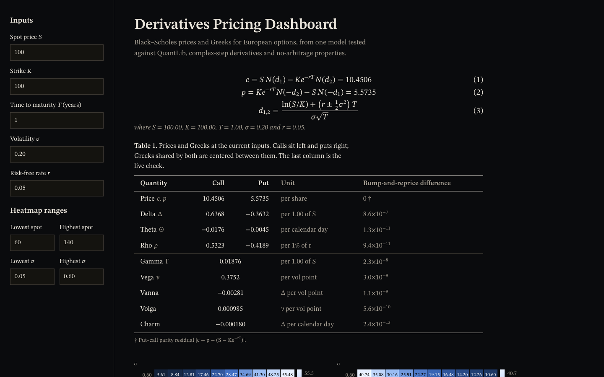
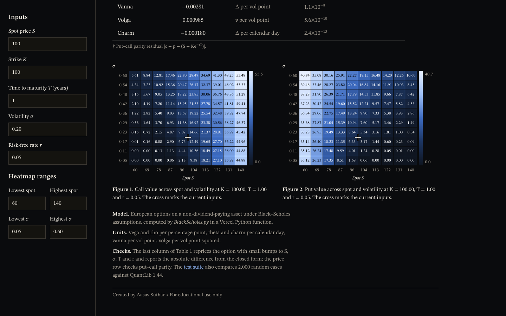

# Derivatives Pricing Dashboard


An interactive **Black–Scholes option pricing dashboard**: a static page on Vercel that calls a Vercel Python function, which prices everything with the tested `BlackScholes.py` model.

**Live demo:** [derivatives-pricing-dashboard.vercel.app](https://derivatives-pricing-dashboard.vercel.app)

---

## 🚀 Features

- **Option Pricing Calculator**
  - Compute European **Call** and **Put** option prices instantly.
  - Full Greeks (delta, gamma, vega, theta, rho, vanna, volga, charm) in trader units.
  - A live check column: each Greek is compared against a bump-and-reprice of the same model, and prices against put–call parity.

- **Interactive Heatmaps**
  - Explore how option prices vary with **Spot Price** and **Volatility** ranges.
  - Side-by-side heatmaps for quick comparison of Call vs. Put dynamics.

- **Customizable Inputs**
  - Spot Price (S)  
  - Strike Price (K)  
  - Time to Maturity (T, in years)  
  - Volatility (σ)  
  - Risk-Free Rate (r)  
  - User-defined ranges for Spot Price and Volatility for heatmaps.

---
## Dependencies

- **numpy**: For mathematical and numerical operations  
- **scipy**: For statistical functions  
- Test-only: **hypothesis** and **QuantLib** (`requirements-dev.txt`)

## Installation
```bash
git clone https://github.com/savsuth/Derivatives-Pricing-Dashboard.git
cd Derivatives-Pricing-Dashboard
pip install -r requirements.txt -r requirements-dev.txt
python3 dev_server.py              # http://localhost:3000
python3 -m unittest discover -s tests
```

##  Results
### Dashboard Overview
<p align="center">
  
  
</p>


