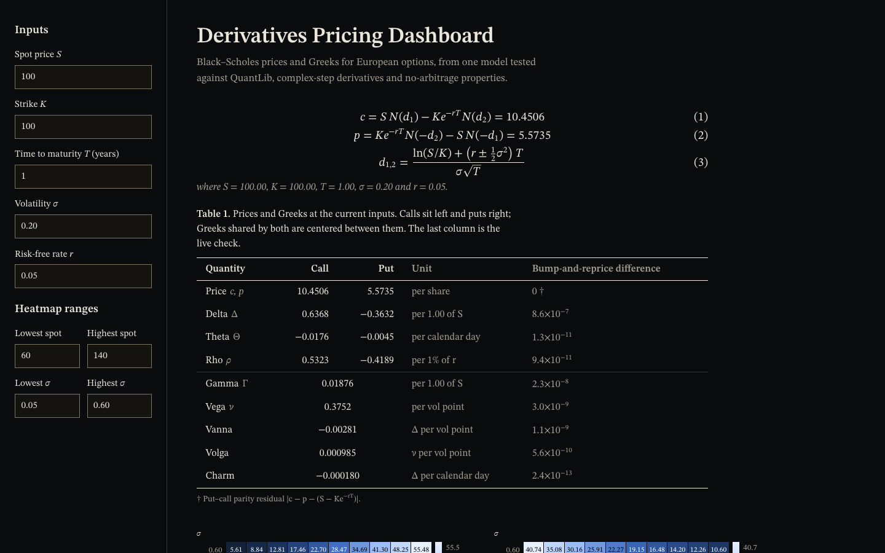
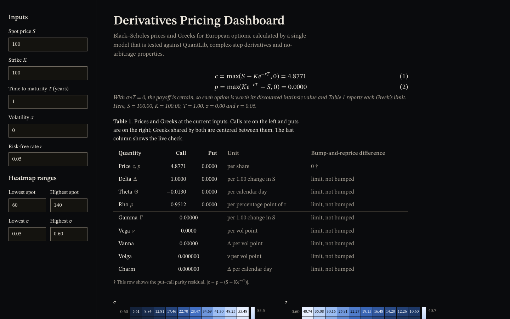
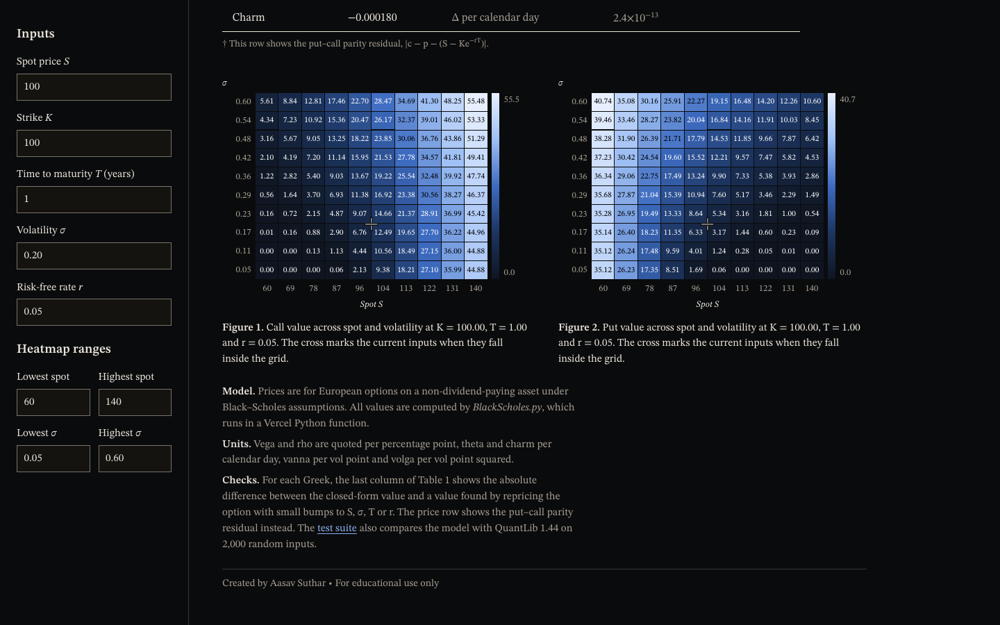

<h1 align="center">Derivatives Pricing Dashboard</h1>

<p align="center">
  Options pricing you can verify.
</p>

<p align="center">
  <a href="https://derivatives-pricing-dashboard.vercel.app"><strong>Open the live demo</strong></a>
</p>

<p align="center">
  
  <a href="LICENSE"></a>
</p>

<p align="center">
  
</p>

## Why This Exists

An option price and its Greeks (how the price responds to changes in its inputs) can look right and still be wrong. Many calculators also break at the edges, returning `NaN` or a wrong number when volatility or time to maturity is zero.

This project makes correctness visible. All numbers come from one tested model, `BlackScholes.py`, which runs in a Vercel Python function. The page only displays the results and contains no pricing math.

## See It Work

All results below use real output from the live site or the test code.

### Every Greek is checked live

For S = 100, K = 100, T = 1, σ = 0.2 and r = 0.05, the page shows:

| Quantity | Call | Put | Unit | Difference |
| --- | ---: | ---: | --- | --- |
| Price | 10.4506 | 5.5735 | per share | 0 (put–call parity) |
| Delta | 0.6368 | −0.3632 | per 1.00 of spot | 8.6×10⁻⁷ |
| Theta | −0.0176 | −0.0045 | per calendar day | 1.3×10⁻¹¹ |
| Rho | 0.5323 | −0.4189 | per 1% of rate | 9.4×10⁻¹¹ |
| Gamma | 0.01876 | same | per 1.00 of spot | 2.3×10⁻⁸ |
| Vega | 0.3752 | same | per volatility point | 3.0×10⁻⁹ |
| Vanna | −0.00281 | same | delta per volatility point | 1.1×10⁻⁹ |
| Volga | 0.000985 | same | vega per volatility point | 5.6×10⁻¹⁰ |
| Charm | −0.000180 | same | delta per calendar day | 2.4×10⁻¹³ |

The last column compares two methods. One is the closed-form formula. The other changes an input slightly, prices the option again and measures the change. The server repeats this check whenever an input changes.

### The results match QuantLib

The test suite compares prices and Greeks with [QuantLib](https://www.quantlib.org/) 1.44 on 2,000 random inputs. In a run of that comparison, the largest relative difference was 8.3×10⁻¹³, and the tests fail above 10⁻⁹. Charm is not available from QuantLib's calculator, so it is checked with complex-step derivatives instead.

The comparison also found a difference in QuantLib's volga. Version 1.44 divides by `stdDev` (σ√T) where the formula needs σ, so its value is too small by a factor of √T. At S = K = 100, T = 4, σ = 0.2 and r = 0.05:

| Source | Volga, per unit of σ² |
| --- | ---: |
| This model | 65.5733 |
| Independent numerical check | 65.5734 |
| QuantLib 1.44 | 32.7867 |

The oracle test applies the √T correction, and a separate complex-step test checks volga without QuantLib.

### Edge cases return defined values

Each row is a request to the live API, with K = 100 and T = 1 unless the row says otherwise:

| Input | Call | Put | Call delta | Gamma | Why |
| --- | ---: | ---: | ---: | ---: | --- |
| S = 100, σ = 0, r = 0.05 | 4.8771 | 0 | 1 | 0 | The payoff is certain, so the call is S − Ke⁻ʳᵀ |
| S = 100, σ = 0, r = −0.02 | 0 | 2.0201 | 0 | 0 | Negative rates work, and the put is now in the money |
| S = 110, T = 0, σ = 0.2, r = 0.05 | 10 | 0 | 1 | 0 | At expiry, the option is worth its intrinsic value |
| S = 95.1229424500714, σ = 0, r = 0.05 | 0 | 0 | 0.5 | ∞ | Spot is at the discounted strike, the kink in the payoff |
| S = −1, σ = 0.2, r = 0.05 | | | | | Status 400 with a message naming the valid ranges |

With σ = 0, the page changes its equations and marks the Greeks as limits instead of showing bump checks:

<p align="center">
  
</p>

### Implied volatility recovers the input

The solver is available from Python and is not in the page yet:

```python
from BlackScholes import BlackScholes

call, put = BlackScholes(1, 100, 100, 0.2, 0.05).run()
print(round(call, 4), round(put, 4))  # 10.4506 5.5735

sigma = BlackScholes.implied_volatility(call, 1, 100, 100, 0.05)
print(round(sigma, 6))  # 0.2
```

It also rejects impossible prices. With S = 100, K = 90, T = 1 and r = 0.05, a call cannot be worth less than 14.39, so a price of 4 raises `ValueError: call price is outside the no-arbitrage bounds`.

### Heatmaps show the whole surface

The function prices each grid with one NumPy broadcast call. A cross marks the current inputs:

<p align="center">
  
</p>

## Run It Yourself

You need Python 3.12 or newer, because the pinned NumPy version requires it.

```bash
git clone https://github.com/savsuth/Derivatives-Pricing-Dashboard.git
cd Derivatives-Pricing-Dashboard
python3 -m venv .venv
source .venv/bin/activate
pip install -r requirements.txt -r requirements-dev.txt
```

Start the page at <http://localhost:3000>:

```bash
python3 dev_server.py
```

Run the 50 tests:

```bash
python3 -m unittest discover -s tests
```

## Call the API

```bash
curl "https://derivatives-pricing-dashboard.vercel.app/api/quote?S=100&K=100&T=1&sigma=0.2&r=0.05"
```

`S`, `K`, `T`, `sigma` and `r` are required. The optional `spot_min`, `spot_max`, `vol_min` and `vol_max` set the heatmap ranges. The JSON response has the keys `inputs`, `degenerate`, `prices`, `greeks`, `checks` and `heatmap`. An infinite Greek is returned as the string `"inf"` or `"-inf"`, and a check is `null` when no bump can be made.

## Limitations

- It prices European options on assets that pay no dividends.
- Volatility and the interest rate are constant, as the Black–Scholes model assumes.
- You enter all inputs by hand. The project does not use market data.
- The first request after an idle period can take a few seconds while the function starts.
- It is for education and is not investment advice.

## License

[MIT](LICENSE), by [Aasav Suthar](https://github.com/savsuth).
